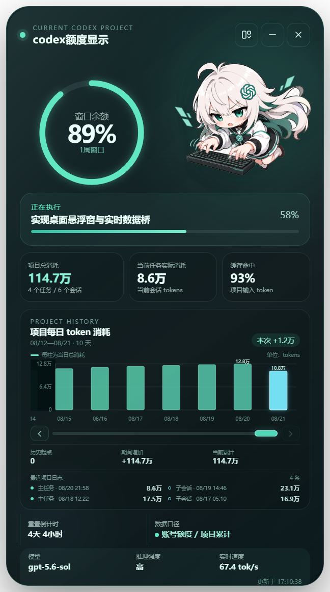

<div align="center">
  
  <h1>Codex 余额助手</h1>
  <p><strong>把 Codex 的任务进度、Token 消耗与用量窗口，变成常驻桌面的二次元助手。</strong></p>
  <p>
    
    
    
    
    
  </p>
  <p>
    <a href="#下载与使用">下载与使用</a> ·
    <a href="#核心能力">核心能力</a> ·
    <a href="#指标口径">指标口径</a> ·
    <a href="#从源码运行">从源码运行</a>
  </p>
</div>

> [!IMPORTANT]
> 本项目是非官方社区工具，与 OpenAI 没有隶属、赞助或背书关系。Codex、ChatGPT、OpenAI 及其标识是其各自权利人的商标。

## 一眼了解

Codex 余额助手是一款 Windows 透明桌面宠物。它以只读方式解析本机 Codex 状态与会话日志，跟随当前选中的项目，实时展示任务状态、计划进度、项目累计 Token、当前任务消耗、缓存命中、模型、推理强度、输出速度与用量窗口余额。

<table>
  <tr>
    <td width="40%" align="center"></td>
    <td width="60%" align="center"></td>
  </tr>
  <tr>
    <td align="center"><strong>精简桌宠</strong><br />人物、任务进度与窗口余额</td>
    <td align="center"><strong>详细面板</strong><br />项目统计、分层图表与实时运行信息</td>
  </tr>
</table>

## 核心能力

- **双形态桌宠**：点击人物在精简版与详细版之间切换，带平滑窗口过渡动画。
- **真实任务状态**：严格跟随 `task_started → working → task_complete`，不会用旧计划伪造完成状态。
- **四种人物状态**：待机、工作、低余额、完成；完成态 15 秒后自动回退，点击人物可立即回退。
- **项目自动跟随**：读取 Codex 当前选中的本地项目，切换项目时同步更新名称和统计。
- **Token 统计**：区分当前任务累计与整个项目累计，并聚合项目子会话。
- **两层消耗图表**：外层按天汇总；点击日期进入当日分时明细，支持滑块、箭头和固定纵轴。
- **运行信息**：显示模型、推理强度、实时输出速度、缓存命中与窗口重置倒计时。
- **本地优先**：不上传提示词、项目内容或 Codex 日志，不修改账号、配置和会话文件。

## 下载与使用

1. 在仓库的 **Releases** 页面下载 `Codex-Meter-v0.2.6-windows-x64.zip`。
2. 完整解压 ZIP，保留目录中的 `resources`、DLL、PAK 等文件。
3. 双击 `Codex余额助手.exe`。
4. 打开 Codex 并选择一个本地项目，桌宠会自动读取对应状态。

系统要求：Windows 10/11 x64，且本机已经使用过 Codex。

> [!NOTE]
> 当前 EXE 未进行商业代码签名，Windows SmartScreen 可能显示“未知发布者”。确认下载来源后，可选择“更多信息 → 仍要运行”。

## 指标口径

| 指标 | 计算与来源 |
|---|---|
| 窗口余额 | 从最新账号级 rate-limit window 计算 `100 - used_percent`；不是现金余额 |
| 当前任务实际消耗 | 当前项目最近用户任务的累计 `total_token_usage.total_tokens` |
| 项目总消耗 | 按项目分配关系和根路径聚合主任务与子会话，并保持累计高水位 |
| 缓存命中 | 项目累计 `cached_input_tokens ÷ input_tokens` |
| 任务进度 | 优先读取 `update_plan` 的 completed / in_progress / pending；无计划时仅显示实时工作状态 |
| 输出速度 | 最近两个有效输出 Token 样本的增量除以时间；超过两分钟无样本则回到待机 |
| 消耗历史 | 从项目会话日志生成累计序列，再按天或日志时间段计算新增 Token |

## 角色状态

| 状态 | 触发条件 |
|---|---|
| 待机 | 没有活跃任务，且窗口余额高于 20% |
| 工作 | 最新任务已开始、尚未收到 Codex 完成事件 |
| 低余额 | 当前用量窗口余额不高于 20%，且不在短暂完成展示期 |
| 完成 | 收到最新任务的完成事件后展示，最多持续 15 秒 |

## 从源码运行

需要 Node.js 20+、npm 和 Windows PowerShell。

```powershell
npm install
npm start
```

默认跟随 Codex 当前选中的项目。如需固定到指定目录：

```powershell
$env:CODEX_METER_PROJECT = "C:\path\to\project"
npm start
```

常用开发命令：

```powershell
npm run check            # JavaScript 语法检查
npm test                 # 自动化测试
npm run preview:capture  # 生成精简版和详细版回归截图
npm run slim             # 删除重复 Electron 开发运行时，复用便携版运行时
```

## 运行与磁盘优化

- 保持 2 秒任务发现频率，日志未变化时复用 10 秒内的聚合快照。
- 活跃日志采用增量读取和安全重叠区，避免反复分配大体积尾部缓冲区。
- 主进程按修订号过滤重复 IPC；图表仅在历史数据变化时重绘，并使用统一事件委托。
- 源码命令与便携版可复用同一套 Electron/Chromium 运行时，避免保存重复的 300+ MB 运行环境。
- Chromium 后台服务、拼写检查、WebGL 与 DevTools 当前保持开启，便于调试和后续视觉扩展。

## 项目结构

```text
electron/   Electron 主进程、安全桥与 Codex 日志监控器
src/        桌宠 UI、交互逻辑与人物状态资源
scripts/    便携版构建、磁盘瘦身和视觉回归脚本
test/       日志解析、任务生命周期与统计口径测试
artifacts/  README 与视觉回归使用的界面截图
dist/       本地生成的 Windows 便携版（不提交到 Git）
```

更完整的技术说明见 [docs/ARCHITECTURE.md](docs/ARCHITECTURE.md)。

## 隐私与安全

- 只读访问本机 Codex 状态文件和会话日志。
- 不读取或展示提示词正文，不上传项目文件或日志。
- 不写入 Codex 账号、配置和会话数据。
- 项目名称、Token 和额度只在本机窗口中渲染。

安全问题请参阅 [SECURITY.md](SECURITY.md)，参与开发请参阅 [CONTRIBUTING.md](CONTRIBUTING.md)。

## 已知限制

- 当前发布包仅支持 Windows x64。
- 指标依赖本机 Codex 日志格式；上游格式变化可能需要适配。
- 余额表示 Codex 日志中的用量窗口百分比，不是 API 账单或账户现金余额。
- 未签名应用可能触发 SmartScreen 或杀毒软件的额外检查。

## 免责声明

这是一个独立的非官方社区项目。软件按“现状”提供，不保证日志格式、额度口径或未来 Codex 版本始终兼容。源代码采用 [MIT License](LICENSE)；人物美术、截图和第三方品牌标识不包含在 MIT 授权中，具体边界见 [ASSET_LICENSE.md](ASSET_LICENSE.md)。
